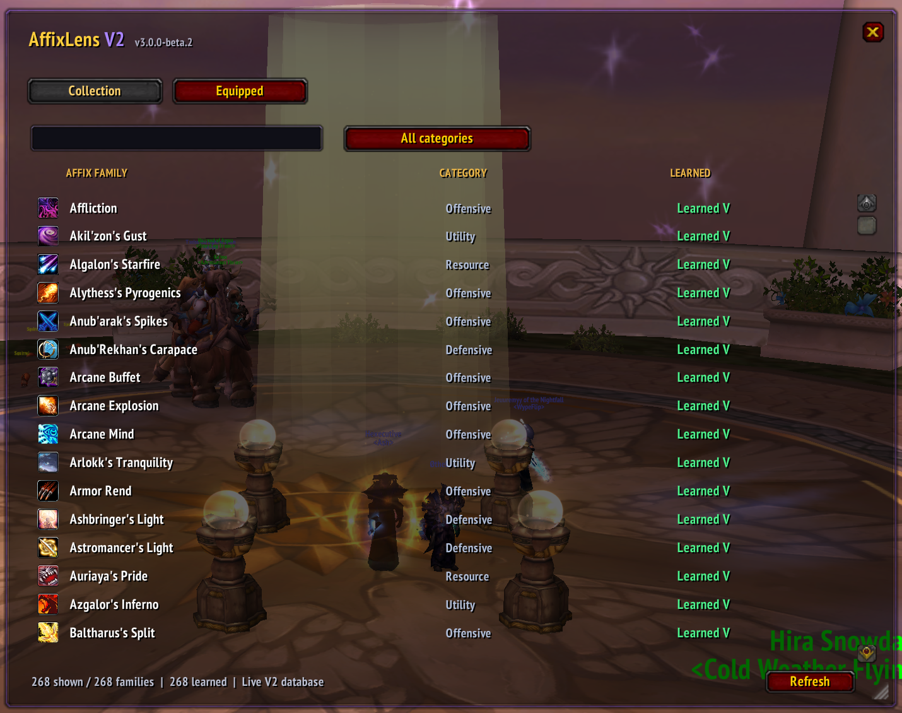
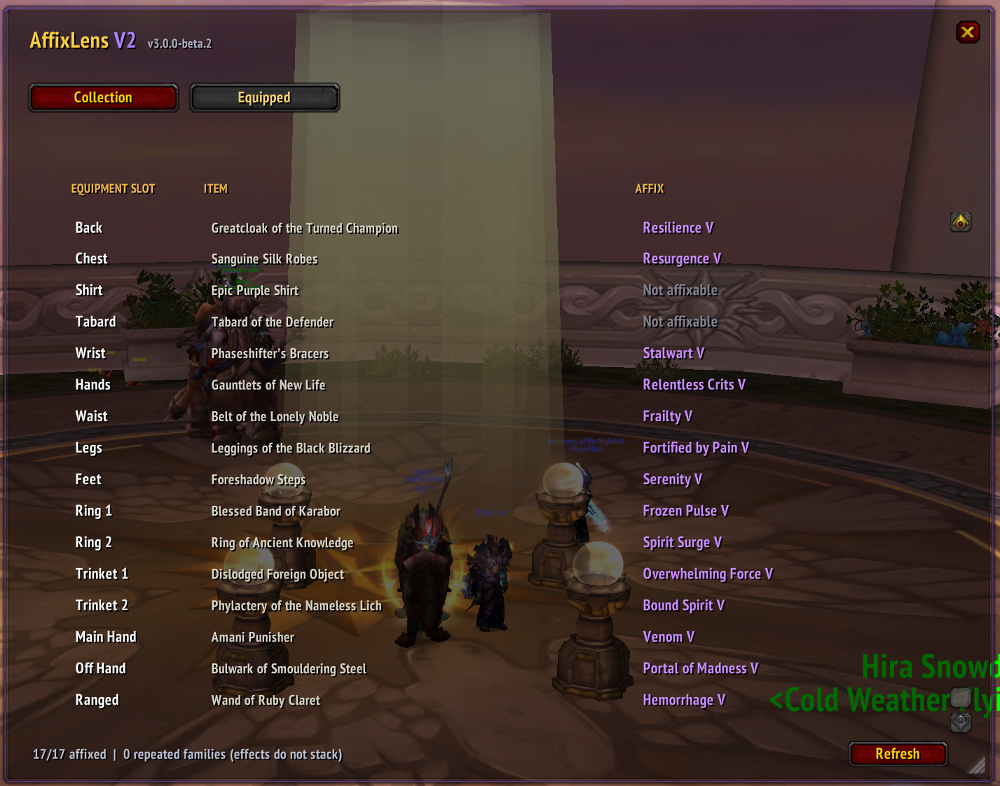

# AffixLens V2 — v3.0.1

**A minimap-driven collection and equipment viewer for Project Ebonhold V2 (WoW 3.3.5a).**

## In-game screenshots

### Collection — browse all 268 V2 affix families

### Equipped — every item, affix, and rank (including wands)

*Screenshots were captured during v3.0.0 beta testing. The same interface is included in v3.0.1.*

## What's new

- Single minimap button: **left-click** to open/close, **drag** to reposition around the minimap.
- One standalone, movable, resizable window with **Collection** and **Equipped** tabs.
- No buttons, inline labels, or other overlays on the character sheet.
- **Collection** lists all 268 V2 affix families, searchable by name, specialization, category, and effect text; cycle category filter with the button. Each family shows its **highest currently learned rank** (I–V), or `Not learned`.
- **Equipped** lists every equipped item and its affix. Hover the **affix column** for that rank's actual description, category, learned state, and application cost. Hover the **item column** for the normal WoW item tooltip.
- Detects equipped affixes via the item's V2 **enchant ID**, then verifies via the actual item tooltip suffix if needed. Never assumes an affix exists because of an item ID alone.
- The **V2 rank upgrade rule** is honored: learning III replaces II, and the bag ! indicator shows **only** a rank greater than your current highest known rank. Existing lower ranks do **not** count as owned or as upgrades.
- Duplicate-family warning, because descriptions say effects do not stack.
- Includes the full V2 catalog captured November 16, 2026 as an **offline metadata-only fallback**. A live Ebonhold catalog takes precedence. This file **never** supplies learned ownership: learned state always comes from the current server connection.
- No requirement for AffixDex or any other library.

## Install

1. **Delete** the previous `Interface/AddOns/AffixLens` folder so old `.toc` files and legacy UI code aren't accidentally reused.
2. Unzip this release into `Interface/AddOns/` so the file exists at `Interface/AddOns/AffixLens/AffixLens.toc`.
3. Restart your WoW 3.3.5a client, or run `/reload` if this was an update of an already-loaded addon.
4. Click the small purple minimap button to open or close AffixLens.

## Commands

| Command | Purpose |
|---|---|
| `/affixlens` or `/affixes` | Toggle window |
| `/affixlens collection` | Open Collection tab |
| `/affixlens equipped` | Open Equipped tab |
| `/affixlens refresh` | Refresh live learned status and item catalog |
| `/affixlens minimap reset` | Reset minimap button position |
| `/affixdiscover on/off` | Control bag upgrade chat/sound alerts (bag ! markers always remain) |
| `/affixbagtest` | Report upgrade items in bags for diagnostics |

## Compatibility & limitations

- V2 slots and allowed categories are based on a live player's verified Anvil behavior. Shirt and tabard remain non-affixable. Ranged/wand is now affixable according to live player verification. The server has not yet supplied verified category restrictions for ranged weapons, so AffixLens displays the applied affix without falsely warning of a category conflict.
- The catalog lists *all classes' affixes*; class and specialization requirements appear in tooltips where available.
- The live learned table must arrive from the server. Until then the UI says `Syncing...`, not a possibly wrong saved rank.
- The offline catalog is a snapshot and may not include affixes introduced in a later patch, but newly introduced live affixes are merged dynamically.
- Bag markers use the normal bag slot tooltips; custom bag addons may use button layouts that aren't detected.
- The Collection/Equipped tabs, hover tooltips, live 268-family catalog, and 17/17 slots (including an affixed wand) were verified in-game on November 17, 2026.

## Credits

Created and maintained by **Stan**. AffixDex by **Noturpalguy** inspired the original catalog and detection approach; its MIT attribution is preserved in [`THIRD_PARTY_LICENSES.txt`](AffixLens/THIRD_PARTY_LICENSES.txt).
