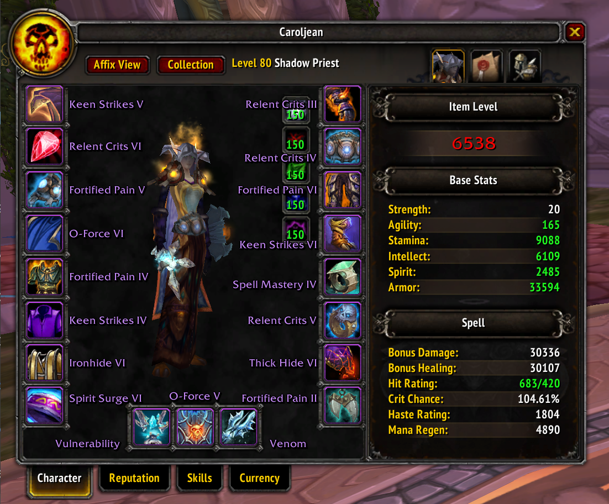
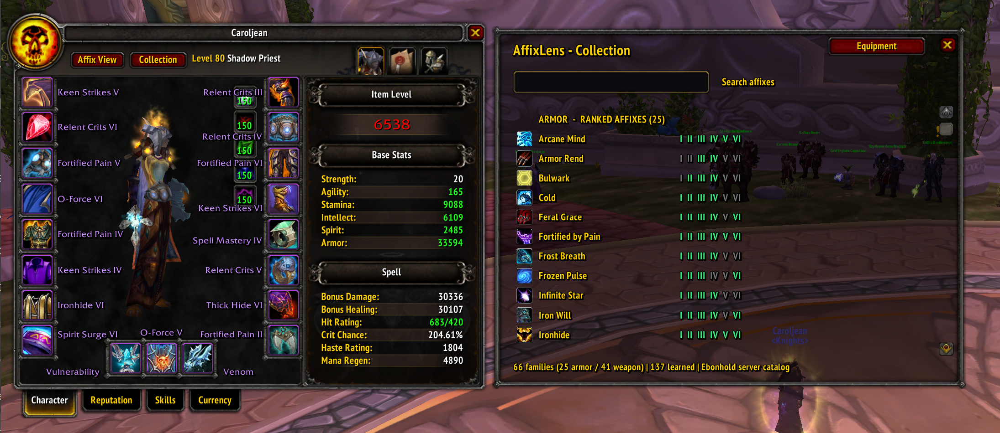
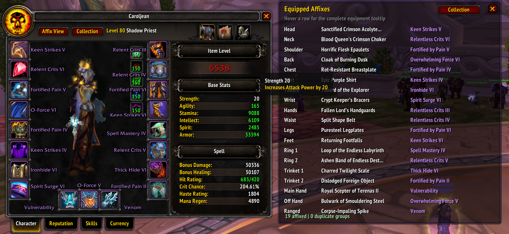

# AffixLens

**Your equipped affixes, learned ranks, and collection  -  all in one place.**

  

AffixLens is an addon for **Project Ebonhold** (World of Warcraft 3.3.5a). It shows affixes right on your character sheet, gives you a complete equipped-gear breakdown, and tracks which armor ranks and weapon affixes you have learned.

**[Download AffixLens](https://github.com/StabbyMcStaber/AffixLens/releases/latest)** · **[Report a problem](https://github.com/StabbyMcStaber/AffixLens/issues)**

## Screenshots

### Your gear, at a glance

Affix names sit beside your equipment slots  -  including the main-hand and ranged weapon affixes. Long names use readable abbreviations rather than losing the important part to `...`.



### Collection: armor ranks and weapon affixes

Browse two alphabetical groups: **Armor** (available Roman-numeral ranks, learned or missing) and **Weapon** (learned or not learned). Filter by name with the search field. The list uses the Ebonhold runtime catalog where available, so affixes don't all have to share the same maximum rank.



### Detailed equipment overview

Open a movable overview listing every equipped item and its current affix. Hover an entry to inspect its equipment tooltip.



## Features

- **Inline equipment labels:** Read each equipped item's affix in your character window. Supports armor, rings, trinkets, main-hand, off-hand, and ranged equipment. Shows `N/A` when no affix is detected.
- **Detailed Affix View:** Inspect slot, item, and affix together in a separate movable window.
- **Accurate duplicate checks:** `Keen Strikes V` and `Keen Strikes VI` are *different* ranks, not duplicates. Only identical ranked affixes are flagged; unranked weapon-only affixes are exempt.
- **Collection tracker:** Separate alphabetical armor/weapon sections, learned state, real available ranks, and search.
- **Weapon recognition:** Identifies named weapon affixes such as **Vulnerability** and **Venom**, not just their proc descriptions.
- **Cleaner labels:** Removes the leading `of`, handles escaped apostrophes, and abbreviates long names meaningfully.
- **Simple window controls:** **Affix View** and **Collection** buttons appear on the character sheet. Clicking the active view closes it; switching views closes the previous one; closing your character window closes both.
- **Ebonhold-aware:** Reads the server-provided affix catalog when available, with fallback information for startup.

## Installation

1. Download the latest **AffixLens** ZIP from [Releases](https://github.com/StabbyMcStaber/AffixLens/releases/latest).
2. Extract it and place the **`AffixLens`** folder in:

   ```text
   ebonhold\Interface\AddOns\AffixLens\
   ```

3. Start the WoW 3.3.5a client. For an update to an existing addon, `/reload` is generally sufficient; a first install may require restarting the game.
4. Open your character window with **C**, then choose **Affix View** or **Collection**.

## Commands

| Command | Action |
|---|---|
| `/affixes` | Equipment view / available equipment commands |
| `/affixcollection` | Toggle Collection |
| `/affixcollection scan` | Refresh your learned collection |

## Compatibility and scope

- **Game:** World of Warcraft 3.3.5a (Wrath of the Lich King)
- **Server:** Project Ebonhold
- **Standalone:** Does **not** require AffixDex to be installed

Version 2.0.0 includes **local** collection tracking. Features from AffixDex such as party comparisons, historical player snapshots, bag highlighting, and expanded learned-state tooltip annotations are **not included** in this release.

## Credits

Created by **Stan**, with development assistance from **CarolJean (ChatGPT)**.

Thanks to **Noturpalguy**, author of [AffixDex](https://github.com/kwilliams312/AffixDex), whose Ebonhold catalog and detection work informed this addon. Original MIT copyright and license notices are preserved in [THIRD_PARTY_LICENSES.txt](AffixLens/THIRD_PARTY_LICENSES.txt). AffixDex remains the original author's work.

## Feedback

Found something wrong or have an idea? [Open an issue](https://github.com/StabbyMcStaber/AffixLens/issues) with the item name, expected affix, and a screenshot if possible.

**Happy farming!**
