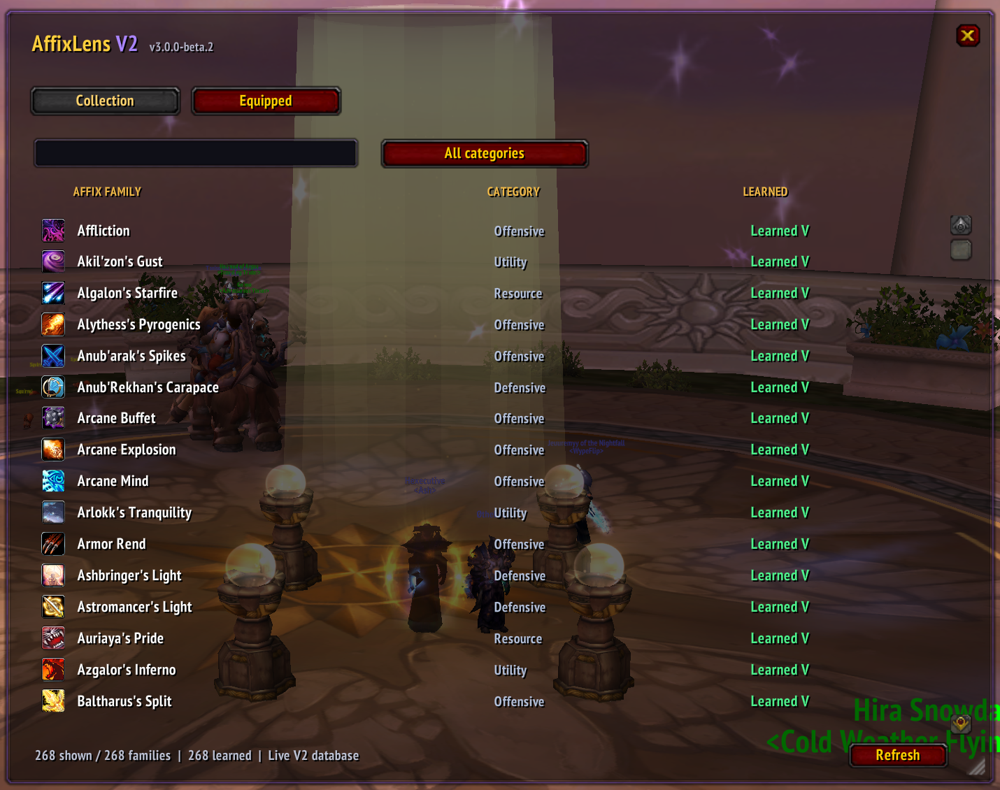
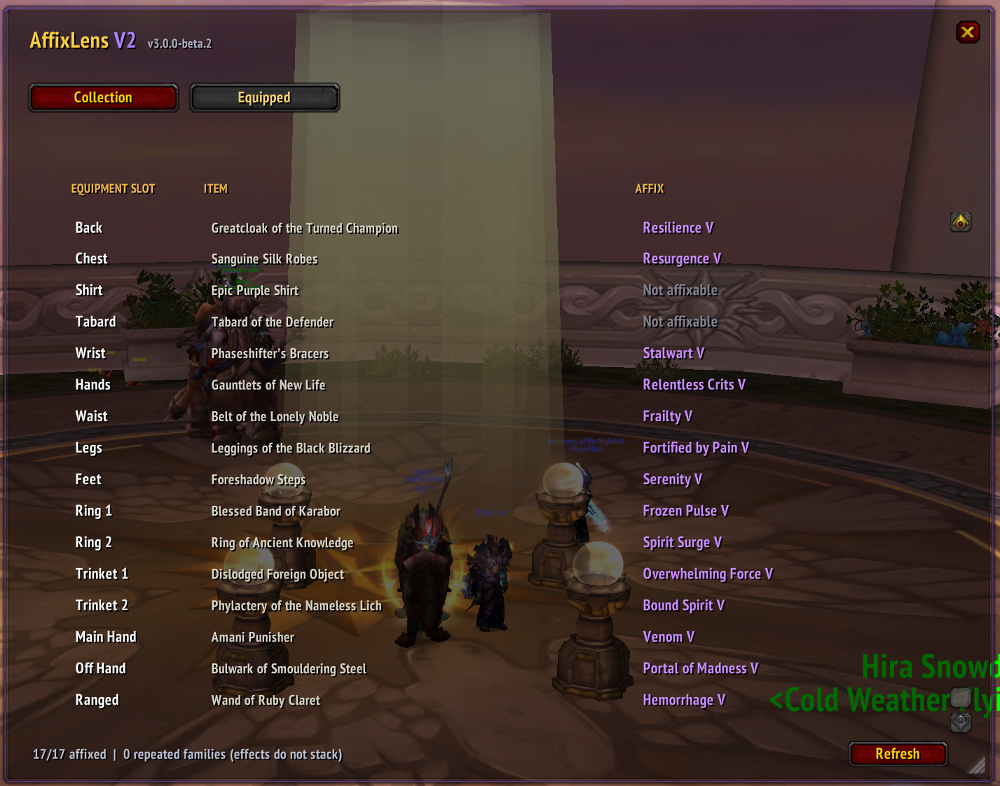

# AffixLens v3.0.1 — Ebonhold V2 Release

Full rewrite for **Project Ebonhold V2**, verified in-game on November 17, 2026.

## v3.0.1 updates

- Added the in-game Collection and Equipped screenshots to the [GitHub README](https://github.com/StabbyMcStaber/AffixLens#in-game-screenshots).
- Cleaned current project credits; preserved the original third-party MIT attribution.
- No changes to equipped-affix behavior since v3.0.0.

## Screenshots

**Collection (268 families):**

**Equipped (17/17, including wand):**

## Highlights

- One draggable minimap icon opens/closes a resizable, movable two-tab window.
- **Collection:** all 268 V2 families from the live database, searchable and filterable, with highest currently learned rank (I–V) and rank-specific hover descriptions.
- **Equipped:** equipment slot, item, and detected affix with item and affix tooltips. Tracks **17/17 affixable slots**, including wands/ranged weapons.
- V2 rank upgrades correctly replace lower learned ranks; bag upgrade markers only show true upgrades.
- Duplicate-family warnings; no legacy character-sheet buttons or overlays.
- Offline catalog snapshot for descriptions if the live catalog isn't ready; learned status always comes from server state.

## Installation

Delete an old `Interface/AddOns/AffixLens` folder, then extract `AffixLens-v3.0.1.zip` into `Interface/AddOns/`. The installed file must be at `Interface/AddOns/AffixLens/AffixLens.toc`. Restart WoW or `/reload`.

## Note

Shirt and Tabard are not affixable. Wands/ranged gear are affixable again. The actual allowed categories for ranged remain unverified and are not guessed by the addon.
